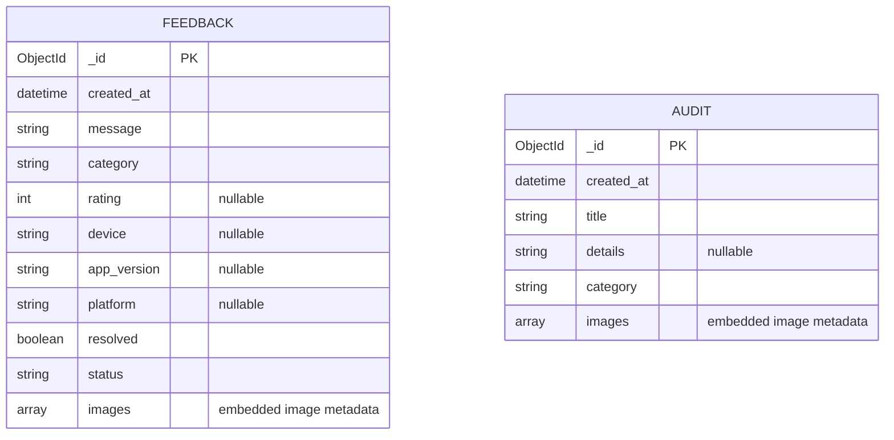
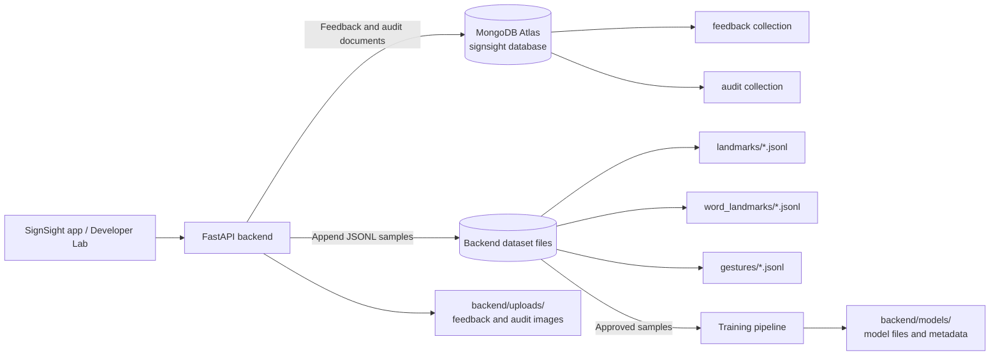

# SignSight Database Design

## Overview

SignSight uses MongoDB Atlas for feedback and admin audit records. MongoDB stores data in **collections** of **documents**; these are the closest equivalents to relational tables and rows.

The backend is configured to use the `signsight` database by default (`MONGO_DB` can override it). The application defines **2 collections**:

| # | Collection | Purpose |
| --- | --- | --- |
| 1 | `feedback` | Feedback submitted by app users, including its resolution state. |
| 2 | `audit` | Admin activity and audit entries, including feedback resolution events. |

This is the collection count defined by the application code. MongoDB creates collections when they are first written to; the live Atlas project may show a different count if other collections were created manually or by older versions.

## Entity relationship diagram

`feedback` and `audit` are separate collections. There is **no database-enforced relationship or foreign key** between them. When an admin resolves feedback, the backend updates the feedback document and adds an audit document whose `details` contains the feedback ID as text.

Image metadata is embedded in each document as an `images` array. The image files themselves are stored on the backend filesystem under `backend/uploads/feedback` or `backend/uploads/audit`, not as MongoDB documents or GridFS objects.

## Collection schemas

### `feedback`

One document per submitted feedback item.

| Field | MongoDB type | Required | Default / notes |
| --- | --- | --- | --- |
| `_id` | `ObjectId` | Yes | Generated by MongoDB. Returned to the API as `id`. |
| `created_at` | `Date` | Yes | Set by the backend in UTC. |
| `message` | `String` | Yes | Trimmed; backend rejects messages shorter than 3 characters. |
| `category` | `String` | Yes | Lowercase; defaults to `general`. |
| `rating` | `Int` or `null` | No | Optional user rating. |
| `device` | `String` or `null` | No | Optional device information. |
| `app_version` | `String` or `null` | No | Optional app version. |
| `platform` | `String` or `null` | No | Optional platform. |
| `resolved` | `Boolean` | Yes | Starts as `false`; set to `true` by an admin action. |
| `status` | `String` | Yes | Starts as `open`; becomes `resolved` with the admin action. |
| `images` | `Array<Object>` | Yes | Defaults to an empty array. See embedded image schema below. |

### `audit`

One document per recorded admin activity or manually created audit entry.

| Field | MongoDB type | Required | Default / notes |
| --- | --- | --- | --- |
| `_id` | `ObjectId` | Yes | Generated by MongoDB. Returned to the API as `id`. |
| `created_at` | `Date` | Yes | Set by the backend in UTC. |
| `title` | `String` | Yes | Trimmed; backend rejects titles shorter than 2 characters. |
| `details` | `String` or `null` | No | Optional description. Resolution events include the feedback ID here as text. |
| `category` | `String` | Yes | One of `ui`, `bug`, `performance`, `feature`, `security`, or `other`; defaults to `other`. |
| `images` | `Array<Object>` | Yes | Defaults to an empty array. See embedded image schema below. |

### Embedded image metadata (`images[]`)

These objects are nested inside a feedback or audit document, not a separate collection.

| Field | MongoDB type | Notes |
| --- | --- | --- |
| `filename` | `String` | Generated filename used to locate the image file. |
| `content_type` | `String` | Uploaded image MIME type. |
| `path` | `String` | Backend filesystem path. |

## Indexes

The backend declares the following indexes in `backend/app/repositories/mongo.py`:

| Collection | Index |
| --- | --- |
| `feedback` | `created_at` descending |
| `feedback` | `resolved` ascending, then `created_at` descending |
| `feedback` | `category` ascending, then `created_at` descending |
| `feedback` | Text index on `message` |
| `audit` | `created_at` descending |
| `audit` | `category` ascending, then `created_at` descending |
| `audit` | Text index on `title` and `details` |

The index setup function is defined in the repository, but it is not currently called from application startup. Treat these as **declared indexes** until index creation is wired into startup or verified in Atlas.

## Data that is not stored in MongoDB

- Admin username, password, and JWT signing secret are read from backend environment configuration; there is no users collection.
- Sign language landmark samples, gesture samples, trained models, and model metadata are stored as files under the backend directories, not in these collections.
- Feedback and audit image bytes are stored in backend upload directories. MongoDB documents contain only image metadata.

### Dataset and model storage

Training samples are **not in the Atlas database** and do not add to the two-collection count. The backend appends one JSON record per line (JSONL) to label-specific files:

| Dataset | File location | Record contents |
| --- | --- | --- |
| Static letter landmarks | `backend/landmarks/<LABEL>.jsonl` | A label, handedness, 21 hand landmarks, capture/reviewer metadata. |
| Static word landmarks | `backend/word_landmarks/<LABEL>.jsonl` | Same landmark record structure as static letters, in a separate directory. |
| Dynamic gestures | `backend/gestures/<LABEL>.jsonl` | A label, hand sequence frames, optional `framesV2`, capture/reviewer metadata. |

The training flow reads approved records from those files and writes trained model artifacts and metadata under `backend/models/`.

Each landmark JSONL record has these fields:

| Field | Typical shape | Meaning |
| --- | --- | --- |
| `label` | String | Letter or static-word label; the file name is based on this label. |
| `handedness` | String | `Left` or `Right`. |
| `landmarks` | Array of 21 points | Hand landmark coordinates used by the classifier. |
| `signer_id` | String or `null` | Signer identifier used for reviewed data and evaluation splits. |
| `capture_session_id` | String or `null` | Capture session identifier. |
| `device_id`, `platform`, `camera_position` | String or `null` | Capture environment metadata. |
| `accepted` | Boolean | Whether the capture was accepted. |
| `review_status` | String | Review state such as `approved`, `pending`, `rejected`, or `legacy`. |
| `review_notes` | String | Optional review comments. |
| `variant_tags` | Array of strings | Optional tags describing sample variation. |
| `captured_at` | ISO datetime string | Capture timestamp. |

Gesture records use the same capture/review metadata, with `frames` for legacy hand-motion sequences and optional `framesV2` for hand plus upper-body sequences instead of the single-frame `landmarks` field.

For the dataset review statuses, capture workflow, and training rules, see [Data and Model Workflow](./data-and-model-workflow.md).

## Source code references

- MongoDB database and collection setup: `backend/app/repositories/mongo.py`
- Feedback document creation and view conversion: `backend/app/services/feedback_service.py`
- Audit document creation and resolution workflow: `backend/app/services/audit_service.py`
- Image metadata and filesystem storage: `backend/app/services/upload_service.py`
- MongoDB configuration: `backend/app/core/config.py`
